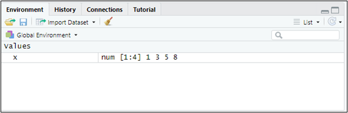

# Almacenando y manipulando datos.

```{r setup-cap02, include=FALSE}
source("_common.R")
library(MATlite)

# Muestra las primeras filas de un data frame (solo para el libro: en la
# consola, el estudiante verá el data frame completo).
.primeras <- function(df, n = 10) print(head(df, n))
```

![[¡Datos, datos!]{.smallcaps}](figuras/02%20robots.jpg){width="100%"}

## {.hicon} Objetos. Datos. {#c02-objetos-datos}

Como vimos en el capítulo 1, R es interactivo: responde a las instrucciones que recibe, ya sea desde la consola o desde un script. Esas instrucciones actúan sobre **objetos**: estructuras o *contenedores* diseñados para almacenar datos y resultados. Los más importantes para nosotros son:

-   Vectores.

-   *Data frames*.

-   Factores.

-   Listas.

Los datos almacenados en los objetos pueden ser, básicamente, de tres tipos: números (`numeric`), cadenas de texto (`character`) o valores lógicos, verdadero o falso (`logical`).

Situémonos en el proyecto que creamos en el capítulo anterior (proyecto "explora") y abramos un script nuevo para practicar.

### {.hicon} Vectores. {#c02-vectores}

Los **vectores** son conjuntos de elementos **del mismo tipo**. Definamos, por ejemplo, el vector x = (1,3,5,8). Para ello escribiremos en nuestro script:

```{r, eval=TRUE, echo=TRUE, warning=FALSE}
x <- c(1,3,5,8)
```

Ejecutamos la línea situando el cursor en cualquier punto de ella y pulsando a la vez las teclas `Control + Enter` (o haciendo clic en el botón `Run` del editor). Ya tenemos en memoria nuestro primer objeto. Conviene reparar en que acabamos de realizar una **asignación**: una flecha formada por los signos "\<" y "-" traslada al vector llamado "x" los elementos 1, 3, 5 y 8, que hemos reunido con la función `c()` (de *combinar*).

Para ver su contenido basta con escribir el nombre del vector, "x":

```{r, eval=TRUE, echo=TRUE, message=FALSE, warning=FALSE}
x
```

Si además dirigimos la mirada a la ventana superior derecha de RStudio, comprobaremos que el ***Global Environment*** —la ventana que recoge los objetos que R mantiene en memoria— muestra nuestro vector:

{.d-block .mx-auto width="100%"}

Un vector puede albergar también cadenas de texto, siempre entrecomilladas. Sirva de ejemplo el vector "genero" (¡evitemos las tildes al nombrar los objetos o podemos encontrarnos con problemas!):

```{r, eval=TRUE, echo=TRUE, message=FALSE, warning=FALSE}
genero <- c("Mujer","Hombre")
genero
```

Cuando falta un dato en un vector, escribiremos "NA" (*not available*, no disponible). Por ejemplo, si no dispusiéramos del tercer dato del vector "Z", lo definiríamos así:

```{r, eval=TRUE, echo=TRUE, message=FALSE, warning=FALSE}
Z <- c(1,2,NA,2,8)
```

Para **seleccionar un elemento** concreto de un vector indicaremos, entre corchetes, la posición que ocupa. Así, para recuperar el tercer elemento del vector "x" haremos:

```{r, eval=TRUE, echo=TRUE, message=FALSE, warning=FALSE}
x[3]
```

### {.hicon} *Data frames*. {#c02-data-frames}

Un ***data frame*** es la estructura con la que más trabajaremos: una tabla en la que las filas son los distintos casos (empresas, personas...) y las columnas, las variables. Cada columna es un vector, y todas tienen la misma longitud.

Construyamos, por ejemplo, el *data frame* **"datos"**, con tres variables —peso, altura y color de ojos, a las que llamaremos "Peso", "Altura" y "Cl.ojos"— referidas a 3 personas. Definimos primero las tres variables como vectores y las reunimos después mediante la función `data.frame()`:

```{r, eval=TRUE, echo=TRUE, message=FALSE, warning=FALSE}
Peso <- c(68,75,88)
Altura <- c(1.6,1.8,1.9)
Cl.ojos <- c("azules","marrones","marrones")
datos <- data.frame(Peso, Altura, Cl.ojos)
datos
```

Para referirnos a una variable concreta de un *data frame* escribiremos el nombre del *data frame*, el símbolo **`$`** y el nombre de la variable:

```{r, eval=TRUE, echo=TRUE, message=FALSE, warning=FALSE}
datos$Peso
```

Y para conocer el número de filas (casos) y de columnas (variables), las funciones `nrow()` y `ncol()`:

```{r, eval=TRUE, echo=TRUE, message=FALSE, warning=FALSE}
nrow(datos)
ncol(datos)
```

### {.hicon} Factores. {#c02-factores}

En R, un **factor** es un tipo especial de objeto destinado a representar **datos categóricos** o atributos: datos que no son magnitudes, sino que pertenecen a un conjunto limitado de categorías, también llamadas *niveles*. Pensemos en la variable "Cl.ojos": para R es, por ahora, un simple vector de texto. Para convertirla en un factor:

```{r, eval=TRUE, echo=TRUE, message=FALSE, warning=FALSE}
Cl.ojosF <- factor(Cl.ojos)
Cl.ojosF
```

"Cl.ojosF" es algo más que un vector de texto: es una variable cuyos elementos solo pueden adoptar dos valores categóricos, los niveles "azules" y "marrones".

¿Por qué conviene, a veces, transformar los datos categóricos en factores? Por dos razones principales:

-   **Orden de las categorías**: podemos fijar en qué orden deben considerarse. Por ejemplo, el estado de una flota de naves puede ser "ANTIGUA", "MADURA" o "RENOVADA", un orden con significado.

-   **Modelos estadísticos**: muchas técnicas reconocen automáticamente los factores como variables cualitativas y les aplican el tratamiento adecuado. Lo comprobaremos en el capítulo dedicado a los modelos de elección discreta, donde utilizaremos la función `lite_factor()` para convertir variables en factores y elegir su categoría de referencia.

### {.hicon} Listas. {#c02-listas}

Por último, una **lista** es un tipo de objeto capaz de albergar en su interior prácticamente cualquier cosa: números, textos, vectores, *data frames*, gráficos, tablas... Podemos imaginarla como una caja organizadora con muchos compartimentos, en cada uno de los cuales cabe un objeto distinto. Creemos, por ejemplo, la lista "mi_lista":

```{r, eval=TRUE, echo=TRUE, message=FALSE, warning=FALSE}
mi_lista <- list(
  nombre = "María",
  edad = 21,
  notas = c(8.5, 9.0, 7.2)
)
```

Para ver solo uno de sus compartimentos utilizaremos, como en los *data frames*, el símbolo `$` seguido de su nombre:

```{r, eval=TRUE, echo=TRUE, message=FALSE, warning=FALSE}
mi_lista$notas
```

Las listas son muy importantes para nosotros, porque **así es como `{MATlite}` nos entrega los resultados de los análisis**: cada función de análisis devuelve una lista con todas sus tablas y gráficos. Escribiendo el nombre del objeto veremos todos sus resultados; escribiendo el nombre, `$` y el nombre de un compartimento, solo ese resultado. Lo veremos en acción a partir del capítulo 3.

## {.hicon} Importando datos. {#c02-importando-datos}

Lo habitual no es teclear los datos, como hemos hecho hasta ahora, sino importarlos a R desde algún archivo externo. En nuestro caso los traeremos desde Microsoft® Excel®. Guardemos en la carpeta del proyecto "explora" los dos archivos de esta práctica, cuyos enlaces de descarga figuran en la sección final del capítulo:

-   Un archivo de Microsoft® Excel® llamado "interestelar_100.xlsx". También podemos descargarlo desde R con `lite_datos("interestelar_100")`.

-   El script "datos_lite.R", con las instrucciones que vamos a mostrar a continuación.

Si abrimos el archivo "interestelar_100.xlsx", comprobaremos que consta de tres hojas: la primera recoge un aviso sobre el uso exclusivo que debe darse a los datos; la segunda describe las variables consideradas; y la tercera (hoja "Datos") contiene la información que vamos a **importar** desde RStudio. Se trata de variables económico-financieras y de otra índole, referidas a una muestra de empresas dedicadas al transporte interestelar de mercancías. Merece la pena fijarse en un detalle: algunas celdas sin dato aparecen en blanco, y otras, con el texto "n.d." (no disponible).

Abramos ahora el script "datos_lite.R" con `File → Open File…` (o haciendo clic sobre el archivo en la ventana inferior derecha de RStudio, pestaña "Files"). Sus primeras instrucciones son:

```{r, eval=TRUE, echo=TRUE, message=FALSE, warning=FALSE}
## Importando datos de las empresas R-Stars

# Limpiando el Global Environment
rm(list = ls())

# Cargando el paquete de la asignatura
library(MATlite)
```

La primera instrucción **limpia el *Global Environment*** (la memoria) de los objetos que hayan quedado de sesiones de trabajo anteriores. La segunda activa el paquete `{MATlite}`, que, como vimos, debe haberse instalado previamente.

Para importar los datos de la hoja "Datos" del archivo "interestelar_100.xlsx" utilizaremos la función `lite_importa()`:

```{r, eval=TRUE, echo=TRUE, message=FALSE}
# DATOS
interestelar_100 <- lite_importa("interestelar_100.xlsx")
```

En el *Global Environment* aparece ya un objeto: un *data frame* llamado "interestelar_100", con 104 filas (una por empresa) y 28 columnas (una por variable). `lite_importa()` ha hecho por nosotros tres cosas:

-   Leer la hoja "Datos" del archivo (si la hoja se llamase de otro modo, la indicaríamos con el argumento `hoja =`).

-   Registrar como dato faltante (*NA*) tanto las celdas en blanco como las que contienen "n.d." (si las ausencias se anotasen de otra forma, la indicaríamos con el argumento `na =`).

-   Tomar la primera columna de la hoja —el nombre de cada empresa— como el **nombre de las filas** del *data frame*, y no como una variable más: no es una característica de las empresas, sino su identificador.

Para explorar el contenido del *data frame* de un vistazo disponemos de la función `lite_resumen()`:

```{r, eval=TRUE, echo=TRUE, message=FALSE, warning=FALSE}
# Resumen visual de las variables
lite_resumen(interestelar_100)
```

La tabla recoge una fila por variable, con su tipo (numérica o de texto), un pequeño gráfico de su distribución, el porcentaje de datos faltantes y, para las variables numéricas, la media, la mediana y la desviación típica.

## {.hicon} Manipulando datos con `{dplyr}`. {#c02-el-paquete-dplyr}

El paquete `{dplyr}` ofrece una gramática sencilla para **manipular** *data frames*: seleccionar variables, ordenar casos, filtrarlos o crear variables nuevas. `{MATlite}` pone a nuestra disposición sus funciones principales, de modo que no hace falta activarlo por separado.

Todas las funciones de `{dplyr}` comparten tres rasgos:

-   El primer argumento es el *data frame* con el que se va a trabajar.

-   Los demás argumentos describen qué hacer con él. Las variables se escriben por su nombre, **sin utilizar el símbolo \$**.

-   El resultado es un **nuevo** *data frame*.

### {.hicon} Seleccionando variables: `select()`. {#c02-seleccionando-columnas-de-un-data-frame}

La función `select()` se queda con las variables (columnas) que le indiquemos. Supongamos que solo nos interesan tres variables de "interestelar_100": ACTIVO, FPIOS y LIQUIDEZ. Crearemos con ellas un nuevo *data frame*, "interestelar_100A":

```{r, eval=TRUE, echo=TRUE, message=FALSE}
# Seleccionando variables
interestelar_100A <- select(interestelar_100, ACTIVO, FPIOS, LIQUIDEZ)
```

En el *Global Environment* figura ahora otro *data frame*, "interestelar_100A", con 3 variables y los mismos 104 casos. Para verlo, basta con escribir su nombre:

```{r, eval=FALSE, echo=TRUE, message=FALSE}
interestelar_100A
```

```{r, eval=TRUE, echo=FALSE, message=FALSE}
.primeras(interestelar_100A)
```

(**Nota:** solo mostramos aquí los 10 primeros casos del *data frame*).

Si lo que queremos es **eliminar** una variable, basta con anteponer a su nombre el signo "-". Por ejemplo, para prescindir de la forma jurídica (FJUR):

```{r, eval=TRUE, echo=TRUE, message=FALSE}
interestelar_100B <- select(interestelar_100, -FJUR)
```

"interestelar_100B" tiene una variable menos (27) que "interestelar_100".

### {.hicon} Ordenando casos: `arrange()`. {#c02-ordenando-casos-de-un-data-frame}

La función `arrange()` ordena los casos (filas) según los valores de una variable, de menor a mayor. Creemos, por ejemplo, el *data frame* "interestelar_100C" con las variables RENECO, EFLO y ACTIVO, y ordenémoslo según la rentabilidad económica (RENECO):

```{r, eval=TRUE, echo=TRUE, message=FALSE}
# Ordenando casos
interestelar_100C <- select(interestelar_100, RENECO, EFLO, ACTIVO)
interestelar_100C <- arrange(interestelar_100C, RENECO)
```

```{r, eval=TRUE, echo=FALSE, message=FALSE}
.primeras(interestelar_100C)
```

Para ordenar de mayor a menor, envolveremos el nombre de la variable en la función `desc()`:

```{r, eval=TRUE, echo=TRUE, message=FALSE}
interestelar_100D <- arrange(interestelar_100C, desc(RENECO))
```

```{r, eval=TRUE, echo=FALSE, message=FALSE}
.primeras(interestelar_100D)
```

### {.hicon} El operador *pipe*. {#c02-el-operador-pipe}

Cuando necesitamos encadenar varias operaciones, resulta muy cómodo el **operador *pipe*** `%>%`: toma el resultado de lo que tiene a su izquierda y se lo pasa como primer argumento a la función que tiene a su derecha. Así, las dos operaciones del apartado anterior (seleccionar variables y ordenar casos) pueden escribirse en una sola secuencia:

```{r, eval=FALSE, echo=TRUE, message=FALSE}
interestelar_100C <- interestelar_100 %>%
  select(RENECO, EFLO, ACTIVO) %>%
  arrange(RENECO)
```

El código se lee de un modo muy natural: "toma `interestelar_100`, selecciona esas tres variables y ordena por RENECO". Lo utilizaremos con frecuencia en los capítulos siguientes, sobre todo para seleccionar las variables de un análisis:

```{r, eval=FALSE, echo=TRUE, message=FALSE}
seleccion <- interestelar_100 %>% select(IDIVERSE, IFIDE, IDIG)
```

### {.hicon} Seleccionando casos: `filter()`. {#c02-seleccionando-casos-de-un-data-frame}

La función `filter()` se queda con los casos que cumplen una o varias condiciones. Por ejemplo, para quedarnos con las empresas con un resultado (RES) mayor o igual a 500 miles de PAVOs, y mostrar solo sus valores de RES y RENECO:

```{r, eval=TRUE, echo=TRUE, message=FALSE}
# Seleccionando casos
interestelar_100 %>%
  filter(RES >= 500) %>%
  select(RES, RENECO)
```

Un mismo filtro admite varias condiciones, que se enlazan con el operador "**&**" (equivale a "y": deben cumplirse todas) o con la barra vertical "**\|**" (equivale a "o": basta con que se cumpla una). Las empresas con un resultado mayor o igual a 500 **y** una rentabilidad económica inferior al 40% son:

```{r, eval=TRUE, echo=TRUE, message=FALSE}
interestelar_100 %>%
  filter(RES >= 500 & RENECO < 40) %>%
  select(RES, RENECO, ACTIVO)
```

Solo una empresa satisface ambas condiciones. Los operadores de comparación más habituales son \>, \<, \>=, \<=, == (igual: atención, con dos símbolos de igualdad seguidos) y != (distinto).

### {.hicon} Creando variables: `mutate()`. {#c02-anadiendo-variables-como-transformacion-de}

Por último, la función `mutate()` añade al *data frame* variables nuevas, calculadas a partir de las existentes. Si necesitamos, por ejemplo, el cociente entre el resultado y el activo de cada empresa, al que llamaremos RATIO:

```{r, eval=TRUE, echo=TRUE, message=FALSE}
# Creando variables a partir de otras variables
interestelar_100 <- mutate(interestelar_100, RATIO = RES / ACTIVO)
```

```{r, eval=TRUE, echo=FALSE, message=FALSE}
.primeras(select(interestelar_100, RES, ACTIVO, RATIO))
```

El *data frame* "interestelar_100" tiene ahora una variable más, RATIO (29 en total).

## {.hicon} Las variables de la base de datos del proyecto R-Stars. {#c02-las-variables-de-la-base-de-datos-del}

La base de datos completa del proyecto R-Stars contiene datos económicos, financieros y operativos de 300 empresas de transporte interestelar de mercancías, recogidos en unas 30 variables. La segunda hoja de cada archivo de Excel describe sus variables, y la ficha detallada de cada una puede consultarse en el apéndice *Bases de datos utilizadas en el libro* de [*R-Stars: La Guía*](https://teckel71.github.io/RStars-book/).

## {.hicon} Materiales para realizar las prácticas del capítulo. {#c02-materiales-para-realizar-las-practicas-del}

En esta sección se recogen los enlaces de acceso a los distintos materiales (*scripts*, datos...) necesarios para desarrollar los contenidos prácticos del capítulo.

**Datos (en formato Microsoft® Excel®):**

-   interestelar_100.xlsx ([obtener aquí](https://raw.githubusercontent.com/teckel71/RStarslite-book/main/download/interestelar_100.xlsx)), o bien, desde R: `lite_datos("interestelar_100")`.

**Script:**

-   datos_lite.R ([obtener aquí](https://raw.githubusercontent.com/teckel71/RStarslite-book/main/download/datos_lite.R))
